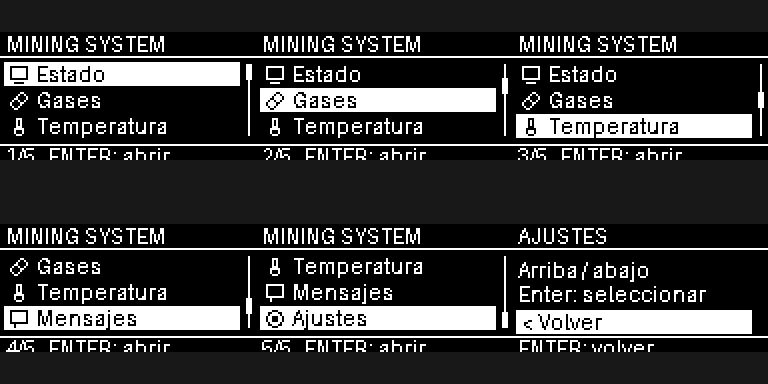

# OLED y botones de la manilla

Implementación inicial para Raspberry Pi Zero 2 W, SSD1306 I²C de 128×64 y tres pulsadores. La interfaz es monocromática: iconos simples, selección invertida, tres filas visibles, barra de desplazamiento y contador de opciones, inspirados en la referencia del menú.

Consultar también [el documento de cableado completo y puesta en marcha](../conexiones.tex), que incluye sensores, alimentación, vibración y opciones de audio.



## Conexiones

Con la Raspberry Pi apagada:

| Elemento | Señal | GPIO BCM | Pin físico |
| --- | --- | --- | --- |
| OLED | VCC | 3,3 V | 1 |
| OLED | GND | GND | 6 |
| OLED | SDA | 2 | 3 |
| OLED | SCL | 3 | 5 |
| Botón subir | Un contacto | 17 | 11 |
| Botón bajar | Un contacto | 27 | 13 |
| Botón enter | Un contacto | 22 | 15 |
| Cada botón | Contacto opuesto | GND | 6 u otro GND |

Los botones usan resistencias pull-up internas: al pulsar conectan el GPIO a GND. En pulsadores de cuatro patas, usar contactos de lados eléctricamente opuestos; comprobar continuidad antes de conectar. No aplicar 5 V a los GPIO. La dirección predeterminada de la OLED es `0x3C`; confirmar la del módulo con `i2cdetect`.

## Preparación de la Raspberry Pi

Desde la raíz del repositorio:

```sh
sudo apt update
sudo apt install python3-venv python3-pip python3-dev python3-lgpio \
  build-essential swig i2c-tools libjpeg-dev zlib1g-dev libfreetype6-dev
sudo raspi-config
```

En `raspi-config`, habilitar I²C en Interface Options y reiniciar si lo solicita. Después:

```sh
i2cdetect -y 1
cd device
python3 -m venv --system-site-packages .venv
.venv/bin/python -m pip install -r requirements.txt
cp -n config/settings.example.json config/settings.json
GPIOZERO_PIN_FACTORY=lgpio .venv/bin/python -m src.main --config config/settings.json
```

El usuario debe tener acceso a I²C y GPIO mediante los grupos `i2c` y `gpio`; Raspberry Pi OS normalmente lo configura. Los pines del JSON usan numeración BCM, no números físicos. `rotate: 2` gira la OLED 180 grados. La configuración local `settings.json` queda excluida de Git.

## Controles y pantallas

- Subir/bajar mueve la selección; al llegar al extremo pasa al otro extremo.
- Enter abre la opción seleccionada.
- En una pantalla de detalle, Enter activa “Volver” y restaura la selección del menú. Subir/bajar no cambian esa pantalla, excepto en Mensajes.
- En **Mensajes**, subir/bajar recorre ocho reportes predeterminados y “Volver”. Enter abre la confirmación; seleccionar **Enviar** o **Cancelar** y pulsar Enter. El resultado muestra **Guardado en cola** hasta recibir confirmación, y después **Enviado a central**. Sin credencial muestra **Sin configurar**.
- Una pulsación produce una acción; mantener pulsado no repite. Antirrebote: 80 ms, configurable.
- Ctrl+C termina el proceso y limpia pantalla y GPIO.

Opciones: Estado, Gases, Temperatura, Mensajes y Ajustes. Estado muestra la conexión real con la central. Mensajes está conectado por WebSocket y utiliza una cola SQLite local para reintentar sin duplicados. Gases, Temperatura y Ajustes conservan las vistas iniciales pendientes de sus controladores físicos; no generan mediciones simuladas ni grabaciones.

Antes de iniciar, registrar un minero y una manilla en la web, guardar su credencial e indicar `connection.url` y `connection.api_key` en `config/settings.json`. Usar la IP de la Raspberry Pi 4 en la URL desde otra máquina. [Inicio rápido y configuración](../../README.md#dispositivo-y-simulador); [protocolo de mensajes](../api.md).

## Probar sin hardware

Solo requiere Pillow y, para la ventana interactiva, Tkinter:

```sh
cd device
python3 -m venv .venv
.venv/bin/python -m pip install 'Pillow>=10,<13'
.venv/bin/python -m src.main --simulate
```

Usar las flechas y Enter, o los botones de la ventana. Escape cierra el simulador. En Linux puede ser necesario instalar `python3-tk`; para Python 3.14 de Homebrew en macOS, instalar `brew install python-tk@3.14`. En otras plataformas usar una distribución de Python con Tkinter.

Para generar una imagen sin ventana y ejecutar las pruebas:

```sh
.venv/bin/python -m src.main --preview /tmp/mining-menu.png
.venv/bin/python -m unittest discover -s tests -v
```

La lógica de menú, el renderizador y las entradas físicas están separados; los callbacks GPIO encolan acciones y el hilo principal actualiza la OLED.

Referencias: [Luma.OLED](https://luma-oled.readthedocs.io/en/stable/python-usage.html), [GPIO Zero: botones](https://gpiozero.readthedocs.io/en/stable/api_input.html#button).

La navegación, las imágenes, los callbacks, la cola y la comunicación de mensajes se verifican sin hardware. Las pruebas de integración utilizan el servidor y WebSockets reales. Falta validar cableado, rebotes reales, comunicación I²C y controladores de sensores en la Raspberry Pi.
