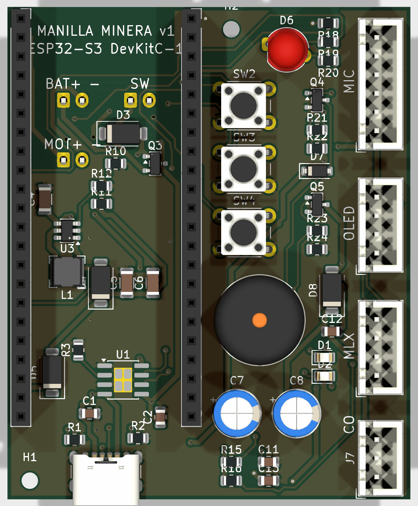

# Placa portadora de la manilla (v1)

PCB de doble cara para la **ESP32-S3-DevKitC-1 N16R8**. La DevKitC se enchufa en
dos zócalos y la placa agrega:
- la carga y protección de la batería LiPo,
- el elevador a 5 V,
- el LED RGB, los tres pulsadores, el buzzer y la etapa del motor,
- conectores JST XH para los módulos (OLED, MLX90614, SEN0564 e INMP441).

Es la primera versión, pensada para recibir la retroalimentación de **ECROBOTICS** antes de fabricarla.



## Qué entregar al fabricante

`fabricacion/manilla-portadora-gerbers.zip`: Gerbers (RS-274X) de las dos caras
de cobre, máscara, serigrafía y pasta, contorno (`Edge_Cuts`) y taladros Excellon.

| Parámetro | Valor |
| --- | --- |
| Tamaño | 54 × 66 mm, rectangular |
| Capas | 2, FR-4 de 1,6 mm, cobre de 1 oz (35 µm) |
| Máscara y serigrafía | en ambas caras |
| Pista mínima | 0,25 mm (señales); potencia a 0,6 mm |
| Separación mínima | 0,25 mm (entre pads del USB-C y del TP4056: 0,29 mm) |
| Vías | 0,8 mm de diámetro, taladro de 0,4 mm (59 vías) |
| Taladros | 0,40 · 0,60 · 0,80 · 0,90 · 0,95 · 1,00 · 1,10 mm metalizados; 2 de 2,2 mm sin metalizar (montaje M2) |
| Ranuras | 4 ranuras ovaladas metalizadas para las pestañas del USB-C |
| Borde | ningún cobre a menos de 0,5 mm del contorno |

Preguntas para ECROBOTICS:
1. ¿Pueden hacer pistas de 0,25 mm con separación de 0,25 mm?
2. ¿Taladros de 0,4 mm metalizados?
3. ¿Ranuras ovaladas metalizadas? Si no, el USB-C hay que cambiarlo por uno con patas redondas.

## Antes de mandarla a fabricar

- **Medir la DevKitC.** La placa usa la distancia del plano oficial de Espressif:
  22,86 mm entre centros de las dos tiras de pines. Si tu clon mide 25,4 mm, hay que corregir `DEVKIT_X`/`J3_X` en `tools/build_pcb.py`.
- **Confirmar los componentes** de la [lista de compras](fabricacion/lista-de-compras.md):
  - el TP4056 debe ser la versión con almohadilla inferior (ESOP-8);
  - el inductor de 22 µH debe medir 4 × 4 mm.

## Archivos

| Ruta | Contenido |
| --- | --- |
| `manilla-portadora.kicad_pro/.kicad_sch/.kicad_pcb` | Proyecto de KiCad 10 |
| `fabricacion/` | Gerbers en zip, [lista de compras](fabricacion/lista-de-compras.md) y `documentos/` |
| `fabricacion/documentos/` | Esquemático en PDF, planos de montaje de cada cara, BOM en CSV, modelo 3D STEP (para diseñar la carcasa) y vistas |
| `tools/` | Scripts que generan todo lo anterior (ver [Regenerar](#regenerar)) |

## Circuito

**Energía**
- **Entrada:** el USB-C de la portadora (J2) solo carga y alimenta. El TP4056 carga a ~545 mA (R3 = 2,2 kΩ).
- **Protección:** el DW01A con Q1/Q2 corta la batería por sobrecarga, sobredescarga y cortocircuito, porque las LiPo de dron como la ANERA de 1000 mAh suelen venir sin protección.
- **Selección de fuente:** con USB conectado, la manilla toma la energía por D3 y Q3 apaga la batería; sin USB, Q3 conecta la batería.
- **Interruptor:** el de la carcasa va en J10, entre SYS y SYS_ON. Apagado, la batería se sigue cargando.
- **Elevador:** el MT3608 sube a 5,1 V (U3, L1 y D4 juntos y sin vías en el nodo de conmutación) y entra por D5 al pin 5V de la DevKitC, cuyo regulador alimenta los 3,3 V de todo. D5 evita chocar con el USB de la DevKitC: se puede programar con la batería encendida.
- **Medición:** VBAT / 2 en el GPIO 1 y detección de USB en el GPIO 2. El firmware todavía no los usa.

**Mapa de pines**

| Función | GPIO | Función | GPIO |
| --- | --- | --- | --- |
| SEN0564 (ADC1) | 4 | I2C SDA / SCL | 8 / 9 |
| Botones subir / bajar / enter | 5 / 6 / 7 | Motor (AO3400A) | 10 |
| LED R / G / B | 15 / 16 / 17 | INMP441 SCK / WS / SD | 41 / 42 / 40 |
| Buzzer (MMBT3904) | 18 | Batería / USB presente | 1 / 2 |

**Conectores** (JST XH de 2,5 mm; el pin 1 es el cuadrado)

| Conector | Pines | Cara |
| --- | --- | --- |
| J5 OLED | 1 GND · 2 3V3 · 3 SCL · 4 SDA | superior |
| J6 MLX90614 | 1 3V3 · 2 GND · 3 SCL · 4 SDA | superior |
| J7 SEN0564 | 1 3V3 · 2 GND · 3 salida | superior |
| J8 INMP441 | 1 VDD · 2 GND · 3 SD · 4 SCK · 5 WS · 6 L/R (GND) | superior |
| J4 batería | 1 BAT+ · 2 BAT− | inferior |
| J9 motor | 1 + (3V3) · 2 − | inferior |
| J10 interruptor | 1 SYS · 2 SYS_ON | inferior |

La antena de la DevKitC queda sobre una zona sin cobre en las dos caras.

## Firmware para esta placa

El mapa de pines del firmware ya corresponde a esta placa, incluido el
micrófono en los GPIO 41/42/40. Lo único distinto del prototipo en protoboard es
el buzzer: aquí lo maneja un transistor y se activa en alto.

```text
config set {"alerts":{"buzzer":{"active_high":true}}}
```

## Montaje sugerido

1. **Cara inferior, SMD:** protección (U2, Q1, Q2, R8, R9, C3), divisores (R6, R7, R13, R14, C9) y R4/R5.
2. **Cara superior, SMD:** chips, diodos y pasivos. La almohadilla del TP4056 se suelda desde abajo, calentando sus 4 vías.
3. **Conectores de la cara inferior** (J4, J9, J10): se insertan por abajo y se sueldan arriba, antes de los zócalos.
4. **Componentes de agujero de la cara superior:** zócalos J1/J3, conectores de módulos, pulsadores, LED, buzzer y C7/C8.
5. **Antes de enchufar la DevKitC**, con la batería conectada y el interruptor cerrado, medir respecto de GND:
   - unos 5,1 V en el cátodo de D4 (salida del MT3608);
   - unos 4,7 V en el pin 5V del zócalo (J1-21), por la caída de D5.

## Regenerar

Los archivos de KiCad se generan con los scripts y no se editan a mano. Requiere el servidor MCP de KiCad (`uv tool install mcp-server-kicad`) y Java para Freerouting.

```sh
PY=~/.local/share/uv/tools/mcp-server-kicad/bin/python
$PY -I tools/build_schematic.py   # esquemático desde las tablas de componentes y redes
$PY -I tools/build_pcb.py         # huellas, contorno, zonas prohibidas y clases de red
$PY -I -c "from mcp_server_kicad import pcb; pcb.autoroute_pcb(pcb_path='$PWD/manilla-portadora.kicad_pcb', output_dir='$PWD/output/routing', max_passes=40, timeout=900)"
$PY -I tools/finish_pcb.py        # ensancha cuellos, planos GND, rótulos y vías de costura
$PY -I tools/drc_summary.py       # DRC: 0 errores, 0 sin conectar
$PY -I tools/export_fab.py        # paquete de fabricación
```

Al cerrar esta versión, el ERC y el DRC daban **0 errores** y **0 conexiones pendientes**. Solo quedan advertencias de serigrafía: referencias que se tocan con pads vecinos. El fabricante recorta la serigrafía que cae sobre cobre.

## Ideas para la v2

- Llevar los conectores de módulos a la cara inferior para acercar la placa al tamaño de la DevKitC (26 × 63 mm).
- Leer el nivel de batería en el firmware (GPIO 1) y enviarlo a la central, que ya tiene el campo `batteryPercent`.
- Ordenar las referencias de serigrafía en el editor de KiCad.
