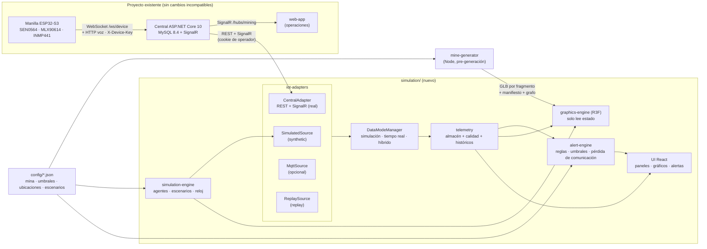

# ARCHITECTURE — Gemelo digital minero

Registro de decisiones de arquitectura (ADR). Cada decisión indica contexto, decisión, consecuencias y estado. Las decisiones marcadas como «Propuesta» se confirman con evidencia durante la fase indicada.

## Vista general

Regla central: **el motor gráfico nunca produce datos**. Solo lee del almacén de telemetría y del estado de simulación. Las fuentes de datos están detrás de una interfaz común y cada lectura conserva su procedencia.

---

## ADR-001 — Ubicación y organización

- **Contexto.** El sistema en uso está en la rama `develop` (`main` está desactualizada, confirmado por el usuario). Contiene `backend/`, `web-app/`, `esp32-device/` (hardware en uso), `device/` (manilla Python, no utilizada), `docs/`, `infra/`, `scripts/` y `tests/`. El prompt maestro pide no reorganizar innecesariamente.
- **Decisión.** El gemelo vive en `simulation/` como monorepo npm con *workspaces* (`apps/twin-web` + `packages/*`). Los paquetes se consumen como código TypeScript (alias de rutas de Vite y referencias de proyecto TS), sin paso de compilación propio.
- **Consecuencias.** Hay que añadir `!/simulation/packages/` al `.gitignore` raíz, cuya regla `packages/` (de .NET) ignora la carpeta. El proyecto existente no cambia de estructura.
- **Estado.** Aceptada (Fase 0).

## ADR-002 — Backend: reutilizar la central existente

- **Contexto.** El prompt sugiere FastAPI/PostgreSQL/MQTT solo si no existe arquitectura. Existe una central ASP.NET Core 10 con MySQL 8.4 (migraciones EF), SignalR tipado, autenticación por cookie, protocolo bidireccional con la manilla ESP32-S3, voz, avisos y despliegue Docker Compose en una Raspberry Pi 4B. La consulta histórica por fecha (`/api/devices/{id}/telemetry?since=&limit=`) ya existe.
- **Decisión.** El gemelo consume la API REST y SignalR actuales mediante `CentralAdapter`, sin cambios en el backend. Si más adelante se necesitara algo nuevo, será aditivo y con migración EF. MQTT queda como adaptador opcional: ningún hardware actual lo usa.
- **Consecuencias.** No se duplica autenticación ni persistencia. El gemelo requiere una sesión de operador (Admin/Supervisor). En desarrollo se autoriza `http://localhost:5180` con `Mining__AllowedOrigins__N`; en producción se sirve desde la Nginx del contenedor `web-app` bajo `/twin/` (cambio aditivo pendiente de aprobación).
- **Estado.** Aceptada (Fase 0).

## ADR-003 — Renderizado: WebGL 2 como base

- **Contexto.** R3F, drei y `postprocessing` (N8AO, SMAA, LUT) están maduros sobre WebGL 2. `WebGPURenderer` de three requiere TSL y un pipeline de posprocesado distinto. super-terrain y RealFire son solo WebGPU.
- **Decisión.** WebGL 2 + R3F 9 como base. WebGPU se evalúa en la Fase 8 con el mismo benchmark y se adopta solo si aporta una mejora medible sin perder funciones.
- **Estado.** Aceptada (Fase 0); revisión en F8.

## ADR-004 — Geometría procedural pre-generada por fragmentos

- **Contexto.** Se piden varios kilómetros de galerías, semillas reproducibles, configuración separada del render y ampliación sin reconstruir todo.
- **Decisión.** `mine-generator` es TypeScript puro y determinista (RNG por semilla, ruido en espacio mundial). Se ejecuta en Node (`bake-mine.mjs`) para producir GLB comprimidos por fragmento, un manifiesto de zonas con volúmenes envolventes, el grafo de navegación y los anclajes. La aplicación carga fragmentos por zona y distancia. El mismo código puede ejecutarse en un *worker* para edición en vivo.
- **Técnica de superficie (F1.5b, decidida en Fase 1).** Campo de distancia con signo (SDF) mallado con *Surface Nets* por fragmentos de 8 m:
  - cada segmento es una unión dura de tramos rectos con sección en herradura; los segmentos y las cámaras se combinan con unión suave (k = 0,9 m), salvo cerca del piso, donde la unión es dura para que dos pisos coplanares no se hundan en el cruce (defecto detectado por la prueba de piso caminable);
  - la irregularidad (fbm + ruido acanalado + ruido celular de facetas) se suma en espacio mundial con amplitud según el sostenimiento;
  - la rejilla se calcula desde índices globales enteros, así que los fragmentos vecinos producen vértices idénticos bit a bit en el borde compartido (prueba: soldadura exacta en float32 sin aristas abiertas con vóxeles de 0,2 m y 0,35 m).
  - **Honestidad sobre el spike:** no se implementó la alternativa de extrusión para compararla. Se eligió SDF porque resuelve cruces, cambios de perfil y cámaras con el mismo mecanismo, y la evidencia es la galería de validación (capturas, pruebas de gálibo, piso y colisión). Si en la Fase 2 el costo de generación resulta prohibitivo, la extrusión queda como alternativa para tramos rectos largos.
- **Medición (galería de validación, 203 m de ejes, vóxel 0,2 m, sombras horneadas, i9-12900K):**
  - un hilo en Node 25: 196 420 triángulos en 9,0 s;
  - en la aplicación, con 8 workers: 2,4 s (ver TESTING.md).

  A ese ritmo, la mina completa (≥ 5 km) tardaría varios minutos en un hilo: por eso se pre-generará en Node (F2.2).
- **Consecuencias.** Cambiar el JSON regenera solo los fragmentos afectados. El ruido en espacio mundial asegura continuidad entre fragmentos.
- **Estado.** Técnica de superficie aceptada (Fase 1). La pre-generación a GLB y la carga por zonas se implementan en F2.

## ADR-005 — Colisiones y selección

- **Decisión.** Cápsula del caminante contra BVH (`three-mesh-bvh`) de las mallas de colisión; la misma BVH sirve para seleccionar por rayos. Vehículos y trabajadores se mueven cinemáticamente sobre el grafo; no requieren física. Rapier se incorporará solo si aparece una necesidad física concreta.
- **Implementación.** `packages/graphics-engine/src/walker.ts` (técnica del ejemplo *characterMovement* de three-mesh-bvh, MIT, acreditada en el archivo). La BVH se construye con la roca; postes, rieles y equipos todavía no colisionan (limitación conocida).
- **Estado.** Aceptada (Fase 1). Evidencia: `packages/graphics-engine/test/walker.test.ts` (recorrido de los 6 segmentos y empuje contra el hastial).

## ADR-006 — Iluminación de túneles

- **Contexto.** Un renderer *forward* no escala a cientos de luces dinámicas con sombras.
- **Decisión implementada (revisada en Fase 1).**
  1. La luz difusa de las luminarias fijas se hornea por vértice al generar, con sombras suaves por marcha sobre el SDF y su dirección dominante. El sombreador usa esa dirección para recuperar el detalle del mapa de normales.
  2. **No se usan `PointLight` de three.js para las luminarias.** Una reserva de N luminarias, las más cercanas a la cámara y con desvanecimiento en el borde del grupo, se pasa como uniformes compartidos (`lampLighting.ts`):
     - en la roca solo aportan brillo especular, atenuado por la luz horneada total del punto (una superficie sin ninguna luz horneada no brilla). La máscara no es por luminaria: dentro de los 16 m de alcance, una luminaria de otra galería puede aportar brillo a través de la roca si el punto recibe luz de otra. Se corregirá con visibilidad por luminaria cuando la red tenga galerías paralelas cercanas (F2);
     - en los objetos no horneados (madera, acero, tuberías y, en F3, maquinaria) aportan difusa y especular.

     Así se evita contar dos veces la difusa de la roca y no hay límite práctico de luminarias.
  3. Los difusores son emisivos HDR (alimentan el *bloom*).
  4. La linterna del casco es una `SpotLight` real con sombra, cuyo tamaño de mapa depende del perfil.
- **Limitaciones.** Los objetos no horneados no reciben sombras de las luminarias fijas, y la reserva se elige por cercanía a la cámara, no por objeto.
- **Estabilidad de programas.** La cantidad de luces (linterna y luz cenital siempre presentes, con intensidad 0 cuando no corresponden) y la de planos de corte (uno siempre, alejado cuando no se corta la bóveda) es constante. Así, cambiar de modo o encender la linterna no recompila los sombreadores; el precalentamiento (`Warmup.tsx`) los compila una sola vez. El mapa de sombra de la linterna solo se actualiza cuando está encendida.
- **Estado.** Aceptada (Fase 1). La medición está en TESTING.md.

## ADR-007 — Modelo de datos con procedencia y calidad obligatorias

- **Decisión.** Toda lectura (`Reading`) incluye `sensorId`, `metric`, `value`, `unit`, `sourceTime`, `receivedAt`, `provenance` (`real` | `device-simulated` | `synthetic` | `replay`, más el adaptador de origen; `device-simulated` corresponde a lecturas con `simulated: true` generadas por el modo `sensors.simulated` de la manilla) y `quality` (`valid` | `stale` | `invalid` | `maintenance` | `uncalibrated`). El almacén separa fuentes para que una lectura simulada nunca sobrescriba una real. Los mensajes externos se validan con zod antes de entrar al almacén.
- **Modos.** Simulación: solo `SimulatedSource`. Tiempo real: solo adaptadores reales; sin generación ante pérdida de conexión. Híbrido: ambos, con distintivo visible de procedencia en cada valor.
- **Ubicación.** `measured` (futuro, si existe posicionamiento real), `assigned-zone` (correspondencia manual), `last-known` y `simulated`; se representan de forma distinta.
- **Estado.** Aceptada (Fase 0).

## ADR-008 — Mapas de calor y capas volumétricas

- **Decisión.** La interpolación se calcula por distancia a lo largo del grafo de galerías (no euclidiana a través de la roca), con un radio máximo por métrica. Fuera de cobertura se muestra un patrón «sin medición». Las capas volumétricas y la niebla son representaciones didácticas, identificadas en la leyenda; nunca alimentan el almacén de lecturas.
- **Estado.** Aceptada (Fase 0).

## ADR-009 — Recursos locales con procedencia verificable

- **Decisión.** Un manifiesto lista cada recurso con fuente, autor, licencia, URL y SHA-256. `fetch-assets` descarga y verifica; `optimize-assets` aplica meshopt, KTX2 (o WebP si `toktx` no está disponible) y variantes de resolución por perfil. Los decodificadores (meshopt, Basis/KTX2 y, si se usa, Draco) se sirven localmente. Una prueba Playwright falla si hay solicitudes a otros orígenes.
- **Estado.** Aceptada (Fase 0).

## ADR-010 — Umbrales configurables con respaldo normativo

- **Decisión.** `config/thresholds.json` define niveles por métrica con histéresis y duración mínima. Cada valor cita su fuente (documento, artículo, URL, fecha de consulta) y tiene `reviewed: false` hasta que lo revise personal competente; la UI muestra el estado de revisión. Sin fuente verificable, no se incluye el umbral.
- **Estado.** Aceptada (Fase 0); contenido en F4.5.

## ADR-011 — Rutas de seguridad

- **Decisión.** Las rutas a refugios del modo de capacitación provienen de `config/training-routes.json` (didácticas o entregadas por personal competente). El sistema no calcula ni recomienda rutas de evacuación a partir de la simulación.
- **Estado.** Aceptada (Fase 0).

## ADR-012 — El nivel de alerta de una lectura real lo decide la manilla

- **Contexto.** La manilla ESP32-S3 clasifica cada muestra (`normal`, `caution`, `danger`) con sus propios umbrales configurables, histéresis y confirmación, y avisa al minero con LED, buzzer y vibración. El gemelo no conoce la configuración vigente de cada manilla.
- **Decisión.** Para lecturas reales se muestra el `level` recibido, identificado como «nivel calculado por la manilla». El gemelo no recalcula ese nivel con otros umbrales. Los umbrales de `config/thresholds.json` se aplican solo a métricas simuladas. El CO sin calibrar (solo `gasVoltage`) se muestra como tensión, con calidad `uncalibrated` y sin equivalencia en ppm.
- **Consecuencias.** El operador y el minero ven el mismo estado de alarma. Si una manilla se reconfigura, el gemelo sigue siendo coherente sin cambios.
- **Estado.** Aceptada (Fase 0, revisión).

## ADR-013 — Minero controlable con la manilla simulada

- **Contexto.** El usuario pidió controlar a un minero dentro de la mina, «como un juego pero realista», con la manilla de `esp32-device/` en la muñeca transmitiendo según el lugar donde está. La manilla real no conoce su posición (la zona la asigna la central), no tiene simulador de escritorio y los navegadores no pueden enviar la cabecera `X-Device-Key` que exige `/ws/device`.
- **Decisión.**
  - **Minero:** modelo procedural articulado (sin recursos externos) con overol de alta visibilidad, cintas reflectivas, casco con lámpara, respirador, botas de goma, batería y autorrescatador. Animación procedural de marcha, carrera, reposo y «mirar la manilla». Usa la misma cápsula contra BVH que la primera persona (ADR-005). Cámara en tercera persona detrás del hombro con colisión por rayo contra la roca, y primera persona desde los ojos del modelo (tecla V).
  - **Manilla:** `packages/device-sim` es un port en TypeScript de `esp32-device/lib/core`: umbrales con confirmación e histéresis, controlador de alertas (LED, buzzer, motor), menú y renderizador de la OLED de 128×64, cola durable en memoria, sesión del enlace (una solicitud en vuelo, heartbeat, telemetría cada 2 s) y alarmas automáticas `CO_ALARM` y `HEAT_ALARM`. Las tramas tienen el formato exacto de `docs/api.md` y llevan `"simulated": true`.
  - **Ambiente:** `packages/mine-environment` calcula CO y temperatura en cualquier punto. Las fuentes decaen con la distancia medida por las galerías (Dijkstra sobre el grafo de nodos) y, si son transitorias (voladura), con una vida media. La manilla mide ese ambiente con la dinámica y el ruido de sus sensores.
  - **Central simulada:** local, responde con los mismos `ack`, identidad y avisos que la central real. No hay conexión con la central real.
- **Alternativas descartadas.**
  - Personaje con animaciones de Mixamo: licencia de redistribución dudosa.
  - Personajes CC0 estilizados (Quaternius, Kenney): no encajan con la estética realista. Se reconsiderarán en F3 para los demás trabajadores.
  - Conectar el navegador directo a `/ws/device`: imposible sin la cabecera `X-Device-Key`. Haría falta un relé (Node) o un cambio en el backend; queda como decisión del usuario (D6).
- **Consecuencias.**
  - El comportamiento visible (niveles, LED, buzzer, pantallas, tramas) sale del mismo algoritmo que el firmware y se verifica con pruebas portadas de `esp32-device/test`.
  - La fuente de la OLED se aproxima con Canvas 2D (Arial con umbral a 1 bit), no con las fuentes Helvetica de U8g2.
  - El modelo ambiental es didáctico: no resuelve caudales ni ventilación (eso es F4).
- **Estado.** Aceptada (2026-11-23).
